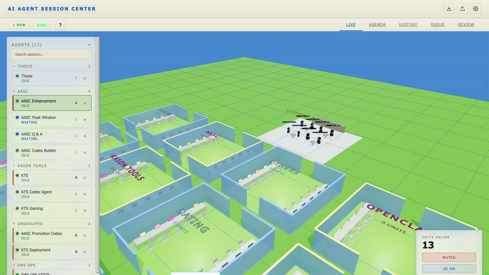

# AI Agent Session Center

**One dashboard for all your Claude Code and Codex sessions — see which agent needs you, work in live terminals, queue the next prompt, and pick your workspace back up after a restart.**

[](https://github.com/coding-by-feng/ai-agent-session-center/releases)
[](https://nodejs.org)
[](./LICENSE)

**[▶ Try the demo in your browser — no install → aasc.work/demo](https://aasc.work/demo)**



---

## Install

### Desktop app (macOS, Apple Silicon)

1. Download `AI.Agent.Session.Center-<version>-arm64.dmg` from the [latest release](https://github.com/coding-by-feng/ai-agent-session-center/releases/latest) and drag the app into **Applications**.
2. The app is **not notarized by Apple**, so macOS says it is **"damaged and can't be opened"**. It isn't damaged — click **Cancel** (not *Move to Trash*), then clear the download quarantine flag in Terminal:

   ```bash
   xattr -cr "/Applications/AI Agent Session Center.app"
   ```

   Then open the app normally. (Or double-click **Open App (Start Here).command** in the DMG, which does the same.) You need to repeat this after installing each new version.
3. Follow the setup wizard and set a password — it keeps other devices on your network out.

### From source (any OS with Node.js 22.12+)

```bash
git clone https://github.com/coding-by-feng/ai-agent-session-center.git
cd ai-agent-session-center
npm install
npm rebuild better-sqlite3 node-pty   # rebuild native modules for your Node
npm run build
npm start                             # opens http://localhost:3333
```

**Requirements:** [Claude Code](https://code.claude.com/docs) and/or [Codex CLI](https://github.com/openai/codex) 0.130+ (Codex hooks are opt-in), and **jq** (`brew install jq`) so events match the right terminal.

### First run

Start the dashboard (it registers its hooks), then run `claude` or `codex` in any terminal — the session appears on **LIVE**. Click it to open its terminal, project, conversation, notes and queue.

---

## Features

- **Know which agent needs you** — working / waiting / approval / input / idle states with sound alerts; rooms, pins, labels.
- **Live terminals** — server-owned xterm.js terminals shared by browser, desktop app and phone; resume, fork, clone, pop-out windows.
- **Prompt queue** — once / loop / scheduled prompts, chains, quiet hours; sent when the session goes idle.
- **Auto-resume** — on overload, 5xx, rate-limit or network errors, sends "continue" for you (3 tries / 30 min, with back-off).
- **Workspace restore** — layout, rooms and sessions come back after a restart.
- **Project browser & transcript** — file tree, fuzzy find, Markdown/TeX/PDF/image viewers, full conversation search, history.
- **Ask about a selection** — explain or translate highlighted text in a floating AI session.
- **Resources** — catalogue of your skills, commands, rules, agents, MCP servers and memory (secrets masked; host only).
- **Themes & 3D** — ten themes, tunable sounds, rebindable shortcuts, optional 3D cyberdrome.

📺 [58-second intro](https://github.com/coding-by-feng/ai-agent-session-center/releases/download/v2.10.40/aasc-product-introduction.mp4) · [12-minute walkthrough](https://github.com/coding-by-feng/ai-agent-session-center/releases/download/v2.10.40/aasc-full-product-walkthrough.mp4)

---

## How it works

```
Claude Code / Codex → hook script (background, never blocks the CLI)
  → /tmp/claude-session-center/queue.jsonl
  → server (match event to session → state machine) → WebSocket → dashboard
```

**What it changes on your machine:** hook entries in `~/.claude/settings.json` (and `~/.codex/config.toml` if enabled), hook scripts in `~/.claude/hooks/`, the terminal tab title, and `<project>/.claude/last-session-id`. Hooks are re-registered every time the server starts. Your data lives in `data/` (source) or `~/Library/Application Support/ai-agent-session-center/` (desktop app).

## Phone and LAN access

Other devices can open `http://<your-address>:3333`, but **only with a password** (otherwise refused). Sessions are **host-only until you share them**, one device drives a session at a time, and it's plain HTTP — use a trusted network or VPN. Anyone with the password can run terminals on this machine, so treat it like SSH access.

---

## Commands

```bash
npm run dev              # hot reload (:3332) + backend (:3333)
npm start                # start the server (after npm run build)
npm start -- --port 4444 # use another port
npm run set-password     # set the dashboard password
npm run uninstall-hooks  # remove hooks from the CLI configs
npm run reset            # remove hooks AND delete history/settings (backed up first)
npm test                 # Vitest
npm run typecheck:all    # type-check client and server
npm run electron:build   # build the desktop installer
```

## Troubleshooting

| Problem | Fix |
|---|---|
| macOS: "damaged and can't be opened" | `xattr -cr "/Applications/AI Agent Session Center.app"` (see [Install](#desktop-app-macos-apple-silicon)) |
| Sessions don't appear | `grep dashboard-hook ~/.claude/settings.json`, then `npm run install-hooks`; make sure `jq` is installed |
| "compiled against a different Node.js version" | `npm rebuild better-sqlite3 node-pty` |
| Port 3333 in use | The server kills whatever holds it; to run a second copy use `--port 4444` |

## Known limitations

- Session matching is heuristic — two sessions in one directory can occasionally cross-link.
- Loops, schedules and auto-resume run in the dashboard, so they pause when no window is open.
- The macOS app is unsigned with no auto-update; the Windows hook is less tested.

## Contributing

Run `npm test`, `npm run lint` and `npm run typecheck:all` before a PR, and use conventional commits (`feat:`, `fix:` …). Per-feature docs live in [`docs/feature/`](docs/feature/README.md).

## License

[MIT](./LICENSE)
