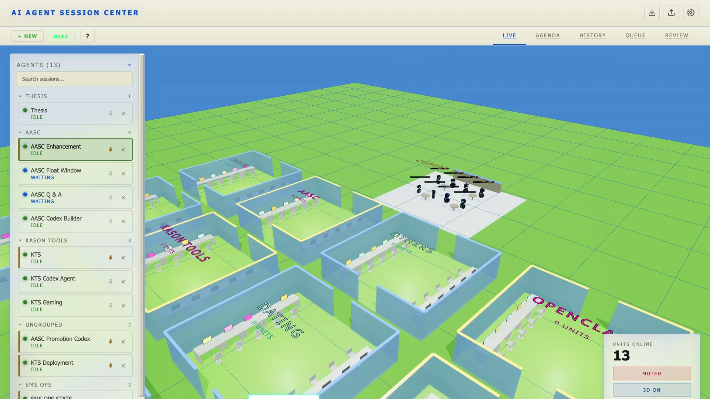

# AI Agent Session Center

**One dashboard for all your Claude Code and Codex sessions — see which agent needs you, work in live terminals, queue the next prompt, answer from your phone, and pick your workspace back up after a restart.**

[](https://github.com/coding-by-feng/ai-agent-session-center/releases)
[](https://nodejs.org)
[](./LICENSE)

**[▶ Take the tour: ten real screens from the desktop and phone apps → aasc.work/tour](https://aasc.work/tour)** · [Download](https://aasc.work/download) · [Docs](https://aasc.work/docs)



---

## Install

### Desktop app

Download from the [latest release](https://github.com/coding-by-feng/ai-agent-session-center/releases/latest) or [aasc.work/download](https://aasc.work/download), which picks your system.

| System | Download |
|---|---|
| macOS, Apple silicon | `.dmg` |
| Windows 10/11, x64 | `Setup <version>.exe` |
| Linux, x64 | `.AppImage` or `.deb` |

**Full or Lite?** Each comes in two editions. Lite is the focused one: terminals, session switching, history, project files, the prompt queue, AI popups, status and alerts, plus sign-in and phone access. Full adds everything under [Features](#features). Both use the same data, so quit one before opening the other.

**Only connecting to another computer?** Install **Full Client** or **Lite Client** instead. They run no server, terminals or hooks: they pair with another computer's AASC and show its dashboard with the Full or Lite look. Same file types as above, with `Full.Client` or `Lite.Client` in the name, and they can run beside Full or Lite.

- **macOS:** drag the app into **Applications** and open it. It is signed with a Developer ID and notarized by Apple, so macOS asks once whether to open an app downloaded from the internet: click **Open**. Versions before v2.10.73 weren't, and macOS called them **"damaged"**; for one of those, click **Cancel**, then run `xattr -cr "/Applications/AI Agent Session Center.app"` in Terminal. On an Intel Mac, run AASC [from source](#from-source-any-os-with-nodejs-2212).
- **Windows:** run the installer. It isn't code-signed, so if SmartScreen says *Windows protected your PC*, choose **More info → Run anyway**.
- **Linux:** `chmod +x` the AppImage and run it; if it doesn't start, install FUSE 2 (`libfuse2`, or `libfuse2t64` on Ubuntu 24.04). On Debian or Ubuntu you can install the package instead: `sudo apt install ./<file>.deb`.

Then follow the setup wizard: it checks your tools, installs the hooks and asks for a password, which keeps other devices on your network out.

### From source (any OS with Node.js 22.12+)

```bash
git clone https://github.com/coding-by-feng/ai-agent-session-center.git
cd ai-agent-session-center
npm install
npm rebuild better-sqlite3 node-pty   # rebuild native modules for your Node
npm run build
npm start                             # opens http://localhost:3333
```

If `npm rebuild` fails, install a compiler: the Xcode Command Line Tools on macOS, `build-essential` on Linux, or the Visual Studio Build Tools on Windows. The package on the npm registry is out of date, so install from GitHub as above.

**Requirements:** [Claude Code](https://code.claude.com/docs) and/or [Codex CLI](https://github.com/openai/codex) 0.130+ (Codex hooks are opt-in). On macOS and Linux, also **jq** (`brew install jq` or `sudo apt install jq`) so events match the right terminal; on Windows the hooks run in PowerShell.

### Updating

- **macOS app:** updates itself. A new version downloads in the background and installs the next time you quit; the app never restarts on its own, so your agents keep running. **Check for Updates…** in the app menu checks now, and **Check for Updates Automatically** turns the background checks on or off.
- **Windows and Linux apps:** download the new version and install it over the old one.
- **From source:** `git pull`, then `npm install`, `npm run build` and `npm start`.

### First run

Start the dashboard (it registers its hooks), then run `claude` or `codex` in any terminal — the session appears on **LIVE**. Click it to open its terminal, project, conversation, notes and queue.

---

## Features

- **Know which agent needs you** — working / waiting / approval / input / idle states with sound alerts; rooms, pins, labels.
- **Live terminals** — server-owned xterm.js terminals shared by browser, desktop app and phone; resume, restart, fork, clone, pop-out windows.
- **Prompt queue** — once / loop / scheduled prompts, chains, quiet hours; sent when the session goes idle. **PROMPTS** lists every prompt you've sent; save any of them to your prompt library or add it to a queue.
- **Auto-resume** — on overload, 5xx, rate-limit or network errors, sends "continue" for you (3 tries / 30 min, with back-off).
- **Workspace restore** — layout, rooms and sessions come back after a restart.
- **Subagents and usage** — the **AGENTS** tab shows a session's subagents as they work; the header shows model, effort, context used and your 5-hour and weekly plan limits.
- **Project browser & transcript** — file tree, fuzzy find, Markdown/TeX/PDF/image viewers, full conversation search, history.
- **Ask about a selection** — explain or translate highlighted text in a floating AI session; **REVIEW** keeps every answer.
- **Agenda** — a personal to-do list with priorities, tags and due dates.
- **Resources** — catalogue of your skills, commands, rules, agents, MCP servers and memory (secrets masked; host only), with usage counts and uninstall. **Project Sync** keeps a project folder in step with an SSH server.
- **Central sessions** (off by default) — one Claude or Codex session watches and steers the others over MCP; anything that's yours to decide asks you first.
- **Themes & 3D** — ten themes, tunable sounds, rebindable shortcuts, optional 3D cyberdrome.

📺 [58-second intro](https://github.com/coding-by-feng/ai-agent-session-center/releases/download/v2.10.40/aasc-product-introduction.mp4) · [12-minute walkthrough](https://github.com/coding-by-feng/ai-agent-session-center/releases/download/v2.10.40/aasc-full-product-walkthrough.mp4) (recorded at v2.10.40)

---

## How it works

```
Claude Code / Codex → hook script (background, never blocks the CLI)
  → /tmp/claude-session-center/queue.jsonl
  → server (match event to session → state machine) → WebSocket → dashboard
```

**What it changes on your machine:** hook entries in `~/.claude/settings.json` (and `~/.codex/config.toml` if enabled), hook scripts in `~/.claude/hooks/` (and `~/.codex/hooks/`), the terminal tab title, and `<project>/.claude/last-session-id`. Hooks are re-registered every time the server starts. Your data lives in `data/` (source) or in the app's data folder, which Full and Lite share: `~/Library/Application Support/ai-agent-session-center/` (macOS), `%APPDATA%\ai-agent-session-center\` (Windows), `~/.config/ai-agent-session-center/` (Linux).

## Phone and other devices

AASC runs on your computer; other devices connect to it. Set a password first (the setup wizard asks for one).

- **Phone browser:** share the sessions you want, then open `http://<your-address>:3333` and sign in.
- **Android app:** download the APK from [aasc.work/phone](https://aasc.work/phone), choose **Pair a phone or computer** in the devices menu and scan the QR code. It finds your computer on your home network or over Tailscale. The iPhone app will come through TestFlight; until then, use Safari.
- **Another computer:** in the desktop app, open the devices menu and choose **Remote computers → Add a computer**, then paste the link from the other computer's **Pair a phone or computer**. Its shared sessions open in their own window.

Without a password every device but this computer is refused. Sessions stay on this computer until you share them (or turn on **Share new sessions with my devices**), and any device you let in can type into a shared session. Anyone with the password can run terminals on this machine, so treat it like SSH access. The connection is plain HTTP: stay on a network you trust, or use a VPN such as Tailscale.

## Headless server and terminal client

Run the server on a Linux box with no desktop (a VPS, a home server), and reach its sessions from a browser, the phone app, or the `aasc` terminal client.

**Server (Linux x64, Node 22, jq).** Download `ai-agent-session-center-<version>-node22-linux-x64.tgz` and its `.sha256` from the [latest release](https://github.com/coding-by-feng/ai-agent-session-center/releases/latest), plus `install-server.sh`, then:

```bash
bash install-server.sh ai-agent-session-center-<version>-node22-linux-x64.tgz   # checks the SHA-256 first
aasc-server setup             # the wizard, including the password a headless server needs
aasc-server install-service   # a systemd user service that starts at boot
aasc-server doctor            # what this box is missing, with the command that fixes each
```

The tarball carries its compiled native modules; on another platform or Node use `npm install -g ai-agent-session-center` (needs a C++ toolchain). `aasc-server status` and `aasc-server logs` show what it is doing.

**Pair.** `aasc-server pair` prints a link and a text QR code. Open it from the phone app, or give it to the client, then answer `y` on the server. `aasc-server devices` lists and revokes them.

**Client (any OS, Node 22+).**

```bash
npm install -g aasc
aasc add '<pairing link>' --name vps   # or: aasc add --ssh you@host  (owner mode over SSH, no pairing)
aasc ls                                # sessions and their status
aasc attach 2                          # this terminal on session 2's; Ctrl-] detaches
aasc send 2 "run the tests"            # or: aasc queue 2 "…" · aasc watch --notify
```

A paired client sees only the sessions you share. The queue, loops and auto-resume still need a dashboard open somewhere (see [Known limitations](#known-limitations)).

---

## Commands

```bash
npm run dev                  # hot reload (:3332) + backend (:3333)
npm start                    # start the server (after npm run build)
npm start -- --port 4444     # use another port
npm run set-password         # set the dashboard password
npm run uninstall-hooks      # remove hooks from the CLI configs
npm run reset                # remove hooks AND delete history/settings (backed up first)
npm test                     # Vitest
npm run typecheck:all        # type-check client and server
npm run electron:build       # build the desktop installer
npm run electron:build:lite  # build the Lite installer
```

## Troubleshooting

| Problem | Fix |
|---|---|
| macOS: "damaged and can't be opened" | Only versions before v2.10.73: install the latest release, or run `xattr -cr "/Applications/AI Agent Session Center.app"` (see [Install](#desktop-app)) |
| Sessions don't appear | `grep dashboard-hook ~/.claude/settings.json`, then `npm run install-hooks`; on macOS and Linux make sure `jq` is installed |
| "compiled against a different Node.js version" | `npm rebuild better-sqlite3 node-pty` (needs a compiler: see [From source](#from-source-any-os-with-nodejs-2212)) |
| Port 3333 in use | The server kills whatever holds it; to run a second copy use `--port 4444` |
| Linux: the AppImage doesn't start | Install `libfuse2` (`libfuse2t64` on Ubuntu 24.04), or use the `.deb` |

## Known limitations

- Session matching is heuristic — two sessions in one directory can occasionally cross-link.
- Loops, schedules and auto-resume run in the dashboard's main window, so they pause while it's closed.
- Windows and Linux builds are unsigned, don't update themselves, and are less tested than macOS; there is no Intel Mac build.

## Contributing

Run `npm test`, `npm run lint` and `npm run typecheck:all` before a PR, and use conventional commits (`feat:`, `fix:` …). User documentation is at [aasc.work/docs](https://aasc.work/docs).

## License

[MIT](./LICENSE)
